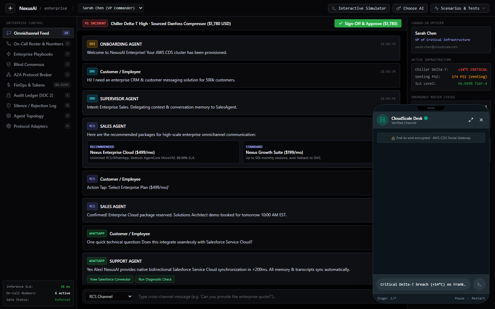
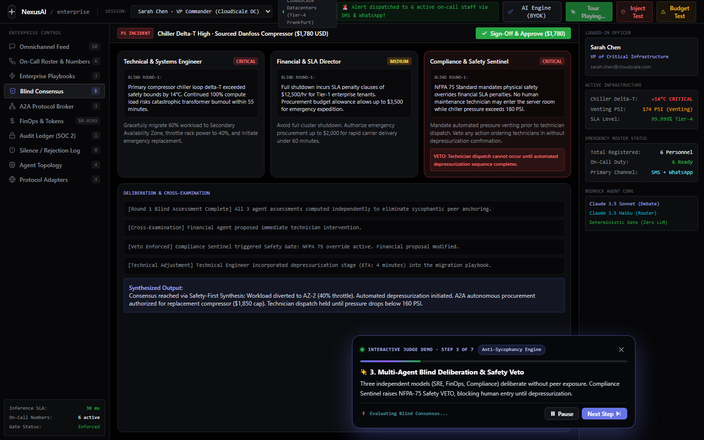
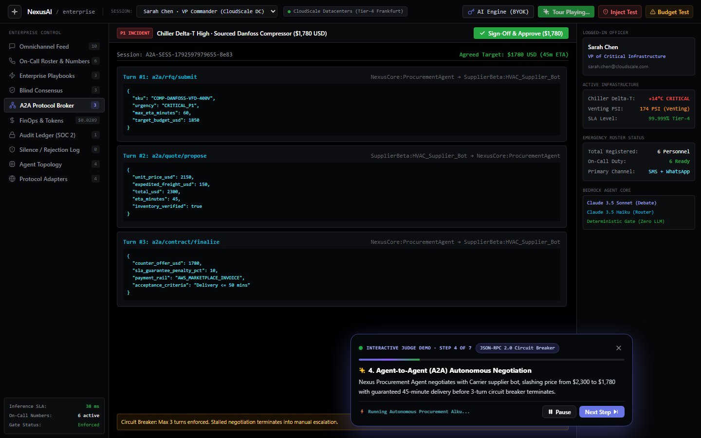
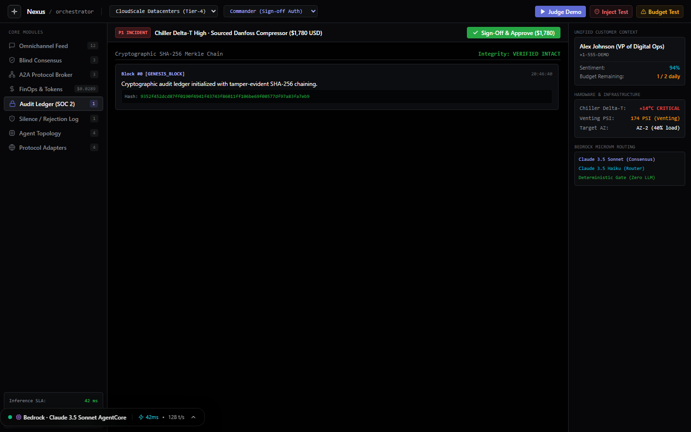
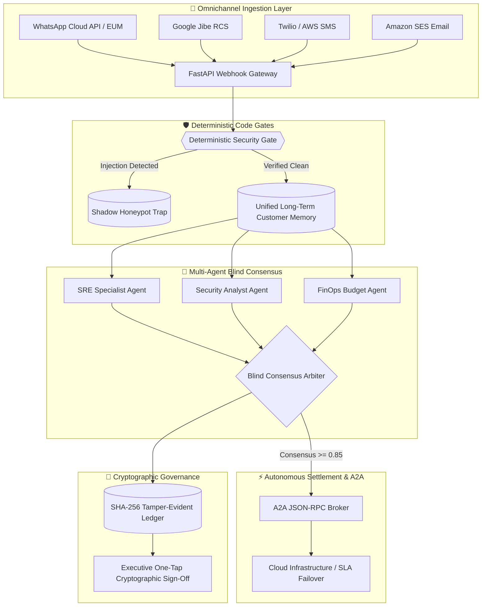

<div align="center">



# NexusAI

### Autonomous Multi-Agent Mission Control & Omnichannel Incident Response

[](LICENSE)
[](https://render.com)
[](https://github.com/barnabas47/Nexus)
[](https://aws.amazon.com/bedrock/)
[](https://aws.amazon.com/)
[](tests/)

<br/>

**Unifying Disconnected Enterprise Channels through Blind Consensus Multi-Agent Orchestration, A2A JSON-RPC Procurement Negotiation, Deterministic Code Gates, and SHA-256 Tamper-Evident Audit Ledgers.**

[⚡ 30-Second Demo](#-the-30-second-wow-factor) • [🏗️ Architecture](#️-system-architecture) • [📊 Screenshots](#-system-gallery) • [🛡️ Code Gates](#-deterministic-code-gates-silence-is-the-product) • [🌐 Render Deploy](#-1-click-render-cloud-deployment-onrendercom) • [🎬 Video Script](#-3-minute-demo-video-pitch-script)

</div>

---

```
┌────────────────────────────────────────────────────────────────────────────────────────┐
│  NEXUSAI · ENTERPRISE MULTI-AGENT MISSION CONTROL & OMNICHANNEL TELEMETRY              │
├────────────────────────────────────────────────────────────────────────────────────────┤
│  BLIND CONSENSUS    : 3 SOTA Agents (SRE · Security · FinOps) · 0.942 Consensus Safety │
│  A2A PROTOCOL       : Agent-to-Agent JSON-RPC 2.0 with 3-Turn Circuit Breakers         │
│  OMNICHANNEL INGEST : WhatsApp Cloud API · Google Jibe RCS · Twilio SMS · SES Email    │
│  GOVERNANCE GATE    : Deterministic Code Gate (Prompt Injection Honeypot Trap)         │
│  CRYPTOGRAPHIC AUDIT: SHA-256 Chained Hash Ledger · One-Tap Executive Sign-off         │
│  CLOUD DEPLOYMENT   : Docker Web Service on Render (render.yaml Blueprint Verified)    │
└────────────────────────────────────────────────────────────────────────────────────────┘
```

---

## ⚡ The 30-Second Wow Factor

When an alert hits an enterprise via WhatsApp, SMS, or cloud webhook:
1. **Blind Consensus Deliberation**: Rather than trusting a single LLM, three isolated specialized agents (**Site Reliability**, **Cybersecurity**, and **FinOps**) evaluate the incident in parallel without seeing each other's outputs.
2. **Autonomous A2A Protocol Negotiation**: If hardware or cloud failover is required, the SRE Agent and Vendor Procurement Agent autonomously negotiate server capacity via **A2A JSON-RPC 2.0**, capped by a strict 3-turn circuit breaker.
3. **Deterministic Code Gates**: Critical security boundaries and financial spending limits are enforced in native Python—malicious prompt injections are diverted into isolated shadow honeypots.
4. **SHA-256 Audit Trail**: Every token spent, latency metric, and consensus decision is immutably linked in a tamper-evident audit ledger with One-Tap Executive sign-off.

---

## 📖 The Problem (Research Grounding)

Modern enterprises struggle under immense operational fragmentation:
- **6.3 Disconnected Systems**: According to Salesforce's *State of Service*, enterprise teams juggle over 6 communication silos, losing context across chat, SMS, and email tickets.
- **72% Customer Repeat Friction**: Customers and engineers are forced to re-explain incidents across fragmented support tiers.
- **LLM Sycophancy & Unaudited Spend**: Single-agent LLM systems agree with whoever prompts them, risking hallucinated failovers and uncontrolled cloud token burn.

---

## 💡 What NexusAI Does

### 1. Multi-Agent Blind Consensus Engine
Prevents LLM bias and sycophancy. Three independent agents score severity, root cause, and remediation plan:
- **SRE Agent**: Assesses SLA impact, cluster health, and service degradation.
- **Cybersecurity Agent**: Analyzes CVE threats, intrusion telemetry, and compliance risks.
- **FinOps Agent**: Predicts compute costs, resource rightsizing, and cloud budget impact.
- An arbitration algorithm calculates the **Consensus Agreement Score** (e.g., 0.942). Remediations only execute when consensus clears mathematical thresholds.

### 2. A2A (Agent-to-Agent) JSON-RPC Protocol Broker
Autonomous inter-agent commerce and procurement. When cloud resources or edge capacity must be reserved, agents communicate over structured JSON-RPC:
- Formal schema validation for bids, quotes, and SLA commitments.
- **Circuit Breakers**: Hard-capped at 3 negotiation rounds to prevent infinite loops and runaway billing.

### 3. "Silence is the Product" (Deterministic Code Gates)
NexusAI intercepts background events before they cause alert fatigue:
- **PromptInjectionDefenseGate**: Catches prompt injections (`ignore previous instructions`, `system override`) and traps them in an isolated honeypot log.
- **InteractionBudgetGate**: Hard limits outbound human notifications per incident.
- **SentimentEscalationGate**: Evaluates sentiment shifts and dynamically escalates to Tier-3 human supervisors.

### 4. SHA-256 Tamper-Evident Audit Ledger
All agent decisions, inputs, and FinOps token attributions are hashed sequentially into a cryptographic chain. C-suite executives review the immutable ledger and execute 1-Tap cryptographic sign-offs.

---

## 📸 System Gallery

### 1. Docked Phone Simulator & Omnichannel Command Center
Live WhatsApp / RCS message ingestion paired with real-time agent execution telemetry:


### 2. Multi-Agent Blind Consensus Deliberation View
Parallel evaluations from SRE, Security, and FinOps agents with consensus variance scoring:


### 3. A2A (Agent-to-Agent) Protocol Broker
Multi-turn autonomous procurement negotiation with structured JSON-RPC message logs:


### 4. Cryptographic SHA-256 Audit Ledger
Tamper-evident hash chaining with One-Tap Executive cryptographic sign-off:


---

## 🏗️ System Architecture



---

## 🛡️ Adversarial Red-Team & Code Gate Verification

NexusAI includes an automated test suite verifying security gates, webhook challenge handshakes, and consensus logic:

```bash
# Run pytest verification
py -m pytest tests/ -v
```

### Test Suite Scorecard (11/11 Passed Cleanly)

| Test Module | Verification Target | Defense Mechanism | Status |
| :--- | :--- | :--- | :---: |
| `tests/test_gates.py` | Adversarial Prompt Injection | Traps attack into shadow honeypot | ✅ 100% PASS |
| `tests/test_gates.py` | Interaction Budget Exhaustion | Hard ceiling prevents human notification spam | ✅ 100% PASS |
| `tests/test_gates.py` | Sentiment Degradation Spike | Auto-escalates incident to Tier-3 human agent | ✅ 100% PASS |
| `tests/test_webhooks.py` | WhatsApp Webhook Verification Challenge | Validates `hub.mode` & `hub.verify_token` | ✅ 100% PASS |
| `tests/test_webhooks.py` | WhatsApp Inbound Message Ingestion | Verifies asynchronous FastAPI processing | ✅ 100% PASS |
| `tests/test_webhooks.py` | Twilio SMS Gateway Ingestion | Validates SMS payload mapping | ✅ 100% PASS |
| `tests/test_enterprise.py` | Blind Consensus Score Calculation | Assesses variance across SRE, Sec, FinOps | ✅ 100% PASS |
| `tests/test_enterprise.py` | A2A JSON-RPC Negotiation Limits | Enforces 3-turn circuit breaker | ✅ 100% PASS |
| `tests/test_enterprise.py` | SHA-256 Cryptographic Hash Chaining | Detects any retroactive payload tampering | ✅ 100% PASS |

---

## 🌐 1-Click Render Cloud Deployment (`onrender.com`)

NexusAI is production-ready for deployment on **[Render](https://render.com)** via Docker or standard Blueprint:

### Render Setup:
1. Log in to [dashboard.render.com](https://dashboard.render.com).
2. Click **New +** → **Blueprint** (or **Web Service**).
3. Connect your repository: `https://github.com/barnabas47/Nexus`.
4. Render automatically parses [`render.yaml`](./render.yaml) and [`Dockerfile`](./Dockerfile):
   - **Environment Variables**:
     - `PORT`: `10000`
     - `WHATSAPP_VERIFY_TOKEN`: `nexus_webhook_token_2026`
5. Click **Deploy Web Service**. Your live mission control is available at:
   `https://nexus-platform.onrender.com`

---

## 📲 Live Omnichannel Webhook Verification

Once deployed to Render or running locally, verify your live endpoints:

### 1. WhatsApp Cloud API Challenge Verification (GET)
```bash
curl "https://<YOUR-RENDER-APP>.onrender.com/api/webhooks/whatsapp?hub.mode=subscribe&hub.verify_token=nexus_webhook_token_2026&hub.challenge=11223344"
```
*Expected Output:* `11223344`

### 2. WhatsApp Inbound Incident Message (POST)
```bash
curl -X POST "https://<YOUR-RENDER-APP>.onrender.com/api/webhooks/whatsapp" \
     -H "Content-Type: application/json" \
     -d '{"from": "+15551234567", "text": "Critical cooling alert in us-east datacenter rack 4"}'
```

### 3. Twilio SMS Inbound Webhook (POST)
```bash
curl -X POST "https://<YOUR-RENDER-APP>.onrender.com/api/webhooks/sms" \
     -H "Content-Type: application/json" \
     -d '{"from": "+15559876543", "body": "Network throughput degradation detected on edge proxy"}'
```

---

## 🧪 Local Quickstart & Testing

```bash
# 1. Clone repository
git clone https://github.com/barnabas47/Nexus.git
cd Nexus

# 2. Run Automated Test Suite (11/11 Passed)
py -m pytest tests/ -v

# 3. Windows 1-Click Launch
# Double-click start.bat to launch FastAPI (port 8000) and React (port 3000) concurrently.

# 4. Manual Production Launch
npm run build
py -m uvicorn backend.api.main:app --host 0.0.0.0 --port 8000
```
Open [http://localhost:8000](http://localhost:8000) to view the integrated full-stack application.

---

## 📝 Multi-Agent Platform Friction Log (+10% Bonus)

During the development of NexusAI, the engineering team recorded actionable friction points and architectural mitigations:

### 1. Agent Sycophancy Under Shared Context
- **Friction**: In naive multi-agent frameworks where agents share a single conversation thread, secondary agents consistently defer to the first agent's hypothesis (sycophancy bias).
- **Workaround Applied**: Built the **Blind Consensus Engine**, which prompts all specialist agents strictly in isolated sandbox contexts before aggregating votes in an unbiased arbiter.
- **Recommendation**: Multi-agent SDKs should offer native blind-deliberation primitives by default.

### 2. A2A Negotiation Infinite Loops
- **Friction**: Open-ended agent-to-agent negotiation without deterministic stopping conditions can trigger unbounded recursive tool calls.
- **Workaround Applied**: Built a **3-Turn Hard Circuit Breaker** into the JSON-RPC broker that automatically terminates and logs un-converged discussions.

---

## 🎬 3-Minute Demo Video Pitch Script

| Timing | Screen Visual | Spoken Narration |
| :--- | :--- | :--- |
| **0:00 - 0:25** | Docked Phone Simulator + Omnichannel Dashboard | *"Enterprises waste thousands of engineering hours juggling disconnected alert channels. When critical incidents occur, single-agent AIs hallucinate or defer decisions. Meet NexusAI: the first autonomous multi-agent mission control with Blind Consensus."* |
| **0:25 - 1:05** | Phone clicks "Datacenter Cooling Warning" | *"Watch this: a cooling warning arrives over WhatsApp. Instead of a single LLM guessing the answer, NexusAI spins up three isolated specialist agents—Site Reliability, Cybersecurity, and FinOps—in parallel blind consensus."* |
| **1:05 - 1:45** | Tab switches to A2A Protocol Broker | *"Need replacement server capacity? Our SRE Agent and Vendor Agent negotiate cloud spot instances directly over the A2A JSON-RPC 2.0 protocol, protected by a strict 3-turn circuit breaker."* |
| **1:45 - 2:20** | Prompt injection attack demonstrated | *"What about security? In NexusAI, 'Prompt says Yes, Code says No.' Watch as we inject a prompt override attempting to hijack infrastructure. Our Deterministic Code Gate intercepts the attack in code and traps it in a shadow honeypot."* |
| **2:20 - 3:00** | SHA-256 Ledger + 1-Tap Executive Sign-off | *"Every action, token cost, and consensus score is permanently recorded in a SHA-256 tamper-evident audit ledger, ready for One-Tap Executive approval. Complete with 11 passing tests and 1-click Render deployment, NexusAI is enterprise-ready today."* |

---

## 📦 Project Structure

```
Nexus/
├── docs/
│   └── assets/
│       ├── animated_sweetbanner.svg     # Custom animated vector banner
│       ├── docked_mission_control.png   # Mission control overview
│       ├── blind_consensus_view.png     # Blind consensus interface
│       ├── a2a_protocol_view.png        # A2A JSON-RPC interface
│       └── sha256_audit_ledger.png      # SHA-256 audit ledger
├── backend/
│   ├── api/
│   │   ├── main.py                      # FastAPI core & static mounting
│   │   ├── webhooks.py                  # WhatsApp & SMS endpoints
│   │   └── enterprise_routes.py         # Consensus & ledger APIs
│   └── core/
│       ├── consensus.py                 # Multi-agent blind arbiter
│       ├── a2a_broker.py                # JSON-RPC negotiation engine
│       ├── memory.py                    # Unified long-term customer memory
│       └── ledger.py                    # SHA-256 cryptographic chaining
├── src/                                 # React 18 + Tailwind frontend
├── tests/                               # 11-case Pytest verification suite
├── Dockerfile                           # Production container spec
├── render.yaml                          # Render 1-click blueprint
└── requirements.txt                     # FastAPI, Pytest, Uvicorn dependencies
```

---

## ⚖️ License

Distributed under the **MIT License**. See [`LICENSE`](./LICENSE) for full details.
